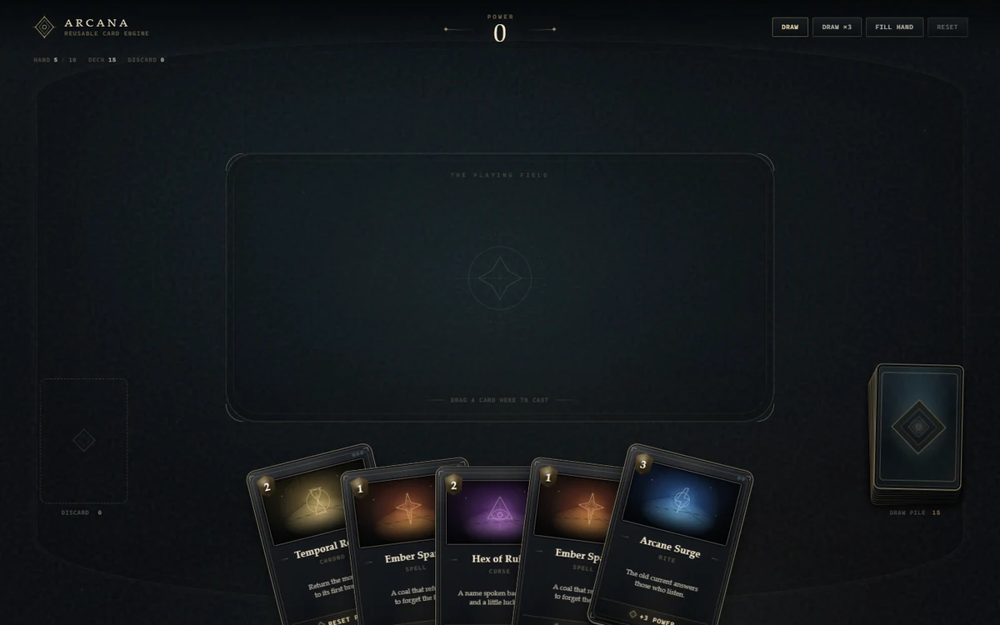

# Arcana — znovupoužitelný karetní engine



Malý, ale funkční karetní engine pro prohlížeč. Je napsaný čistě v **HTML, CSS a vanilla JavaScriptu**, bez frameworků, závislostí a bez build kroku. Vychází z pocitu karet v Hearthstoneu, ale grafiku ani konkrétní design nekopíruje — všechny karty, rubová strana, runy a efekty jsou generované pomocí CSS a inline SVG.

Projekt je záměrně **engine, ne hotová hra**. Herní logika je oddělená od vykreslování, vstupů a animací, takže se dá vzít jako základ pro jinou fantasy karetní hru, deckbuilder nebo soubojový prototyp.

---

## Co je hotové

- realisticky vrstvený lízací balíček s viditelnou tloušťkou,
- plastické karty s rámečkem, vnitřním osvětlením, stínem, leskem a 3D náklonem,
- jednotné zaoblené rohy všech karet — v ruce, v balíčku, na discardu i během letu,
- balíček a discard přesně odpovídají skutečnému počtu karet (1 karta = 1 karta),
- vějířová ruka pro 1–10 karet s dynamickým rozestupem, rotací a obloukem,
- plynulý hover: karta vyjede, zvětší se, narovná se a dostane se nad sousedy,
- líznutí z balíčku: karta vyjede ve stejné velikosti i úhlu, jako má vrchní karta balíčku, a teprve po opuštění hromádky se zvětší; rub se tak nikdy nepřekrývá s jinak velkým rubem,
- drag & drop z ruky do herního pole s náklonem podle pohybu, stínem a zvýrazněním cíle,
- vrácení karty do ruky při neplatném puštění (bez provedení efektu),
- animované přeuspořádání ruky při přidání, odebrání i tažení karty,
- použití karty: efekt se provede **přesně jednou**, karta se buď odhodí lícem nahoru, nebo se zničí,
- odhazovací balíček s vrchní kartou lícem nahoru a viditelnými hranami dalších karet,
- demonstrační čítač Power, plovoucí `+1` / `-2` indikátory a efektivní efektový systém,
- testovací ovládání, maximální velikost ruky 10, počty karet a reset,
- respektování `prefers-reduced-motion`,
- funguje i po přímém otevření `index.html` (`file://`), není potřeba server.

---

## Spuštění

### Nejjednodušeji

Otevři `index.html` přímo v prohlížeči. Skripty jsou klasické, nejsou to ES moduly, takže projektu nevadí `file://`.

### Doporučeně přes lokální server

```bash
cd DeepseekWorker
python -m http.server 8080
```

Potom otevři [http://localhost:8080](http://localhost:8080).

Není potřeba `npm install`, `pnpm` ani žádný bundler.

---

## Ovládání

| Akce | Výsledek |
| --- | --- |
| Najetí na kartu v ruce | Zvětšení, vyjetí a zarovnání karty pro čtení |
| Klik / stisk na kartu a tahání | Karta se odpojí z vějíře a následuje kurzor/prst |
| Puštění nad herním polem | Provede se efekt, karta se odhodí nebo zničí |
| Puštění mimo herní pole | Karta se vrátí do ruky, nic se nestane |
| Klik na lízací balíček | Líznutí jedné karty |
| `Draw` / `Draw ×3` | Testovací líznutí |
| `Fill hand` | Doplnění ruky do 10 karet |
| `Reset` | Nová hra, 5 karet v ruce a 15 v balíčku |
| `Esc` | Zruší rozpracované tažení |

Na dotykových zařízeních funguje tažení prstem. Hover je aktivní pouze tam, kde dává smysl (myš / trackpad).

### Demonstrační karty

| Karta | Efekt | Po zahrání |
| --- | --- | --- |
| Ember Spark | `+1 Power` | odhodí se |
| Arcane Surge | `+3 Power` | odhodí se |
| Mana Siphon | `-1 Power` | odhodí se |
| Hex of Ruin | `-2 Power` | odhodí se |
| Temporal Reset | nastaví Power na 0 | zničí se |
| Void Ember | `+2 Power` | zničí se |

Balíček má 20 karet. Počáteční ruka má 5 karet, zbytek je v lízacím balíčku. Shuffle používá deterministický seed, takže je demo při každém spuštění reprodukovatelné; seed se mění v `js/config.js`.

---

## Architektura

Projekt používá jeden globální namespace `window.CGE`, klasické `<script>` soubory a žádné externí závislosti. Pořadí načítání je v `index.html`.

| Soubor | Odpovědnost |
| --- | --- |
| `js/engine.js` | Autoritativní stav, balíček, ruka, discard, validace zahrání, provedení efektu, eventy |
| `js/cards.js` | Čistá data karet (`CARD_DEFINITIONS`) a sestavení balíčku |
| `js/effects.js` | Registr efektů; typ efektu je jen řetězec v definici karty |
| `js/demo.js` | Ukázková „hra“: čítač Power, napojení na eventy, HUD, toasty |
| `js/layout.js` | Čistý výpočet vějíře a hover pozice, žádný DOM |
| `js/view.js` | DOM jedné karty (`CardView`), její obsah, materiál a transformace |
| `js/renderer.js` | Vykreslování karet, balíčků, discardu, choreografie animací a efekty |
| `js/interactions.js` | Hover, tažení, pointer capture, detekce drop zóny, vrácení karty |
| `js/animator.js` | Jeden RAF tween systém, max. jedna animace na kartu |
| `js/events.js` | Malý synchronní event bus |
| `js/config.js` | Veřejné konfigurační hodnoty a složení demonstračního balíčku |
| `js/app.js` | Jediné místo, kde se engine, renderer, ukázková hra a UI propojí |
| `tests/cdp.mjs` | Volitelný Chrome DevTools testovací scénář (bez npm závislostí) |

### Klíčové oddělení: stav vs. animace

Tohle je nejdůležitější princip celého projektu:

1. **`CardEngine`** rozhoduje okamžitě. Když hráč pustí kartu do platné zóny, karta zmizí z ruky, efekt se provede jednou a karta se zapíše do discardu nebo mezi zničené. Engine nezná pixely ani animace.
2. **`TableRenderer`** dostane event (`card:played`, `card:drawn`) a teprve řeší, jak se karta vizuálně přesune, otočí, odhodí nebo rozpustí.
3. **`Animator`** vlastní právě jednu animaci na jednu kartu. Nová animace předchozí bezpečně zruší, takže se transformace neperou.
4. **`InteractionController`** drží pouze přechodný stav tažení. Ten není součástí herního stavu — karta je pořád v ruce, dokud ji hráč nepustí do platné zóny.

Díky tomu funguje i rychlé klikanání, reset uprostřed animace nebo přerušení letu karty.

---

## Výkon a plynulost

Při optimalizaci jsem nešel cestou přepsání rendereru, ale nejdřív hledal konkrétní příčiny. Mezi hlavní patřily:

- lízací balíček se při každé změně počtu karet znovu skládal přes `replaceChildren()`,
- letící karta používala jiný rub než balíček, takže při startu líznutí vznikl pocit změny textury,
- pointer pohyby volaly `getBoundingClientRect()` a vynucovaly layout,
- hover měnil velký `box-shadow` přes CSS transition, což znamená repaint každý frame,
- lesk karty měnil origin radial-gradientu přes CSS proměnné, místo aby se posouvala hotová vrstva,
- `DemoUI` a tlačítka používaly `void offsetWidth` pro restart animace, což vyvolalo synchronní layout,
- každá karta se při líznutí znovu parsovala z velkého HTML stringu.

Aktuální implementace:

- drží fixní pool osmi vrstev balíčku a jen přepíná jejich viditelnost,
- používá stejný CSS povrch pro rub karty i vrstvy balíčku,
- cachuje geometrii stage, ruky, play zóny, balíčku a discardu,
- počítá hit-test i lesk z pozic v JavaScriptu, bez čtení layoutu v pointer hot-path,
- animuje pouze `transform` a `opacity`; hover stín je pseudo-element s animovanou opacity,
- používá šablonu DOM pro každou definici karty a instance klonuje,
- má jeden RAF tween systém s jednou aktivní animací na kartu a `will-change` jen po dobu animace,
- sdružuje aktualizace HUD a přeskakuje no-op reflow.

Měření v headless Chrome 155 (stejný syntetický scénář: 5 rychlých líznutí + drag do play zóny, 3 běhy):

| Metrika | Před | Po |
| --- | ---: | ---: |
| `ScriptDuration` (medián) | 0,080 s | 0,050 s |
| `TaskDuration` (medián) | 1,279 s | 1,023 s |
| `RecalcStyleCount` (medián) | 293 | 262 |
| `LayoutCount` | 16 | 9 |
| p95 frame interval | 17,1–33,3 ms | 16,9–17,2 ms |
| frames > 20 ms | 11–17 | 0–8 |
| DOM mutace balíčku při líznutí | 15 | 0 |

Jde o syntetické měření v headless prostředí, ne o záruku 60 FPS na každém zařízení. Long tasky byly v obou měřeních nulové; zbytkové ojedinělé framy nad 20 ms mohou přicházet z prostředí nebo z kompozice velkých stínů.

---

## Rozložení ruky

Vějíř je záměrně organický, ale není náhodný. Pozice, rotace i svislý oblouk se počítají symetricky z normalizované pozice karty. Lichý počet má skutečně centrovanou prostřední kartu, sudý počet se zrcadlí kolem středu. Střed ruky je níže než kraje a krajní karty se roztáčejí ven.

Při kontrole jsem nenašel chybu v zarovnání, která by vysvětlovala „rozházený“ dojem — jde hlavně o překryv rotovaných karet a jejich rozdílné obalové boxy. Proto jsem tento charakter zachoval a změnil pouze materiál, rohy a stíny. Layout je otestovaný pro 1, 2, 3, 5, 7 a 10 karet a všech 10 karet zůstává dostupných na desktopu i na mobilu.

---

## Přidání karty

Stačí přidat definici do `js/cards.js`:

```js
{
  id: "frost-lance",
  name: "Frost Lance",
  type: "Spell",
  description: "A shard of winter, thrown true.",
  effectLabel: "+2 Power",
  effect: { type: "power.add", amount: 2 },
  disposition: "discard",          // "discard" | "destroy"
  cost: 2,
  rarity: "rare",                  // common | rare | epic
  rune: "surge",                   // vestavěný CSS/SVG rune
  palette: { a: "#0d1b2b", b: "#315c7a", c: "#a9d8ef" },
  artwork: null                    // nebo např. "assets/frost-lance.webp"
}
```

Potom ji přidej do `CGE.DECK_RECIPE` v `js/config.js`:

```js
{ definitionId: "frost-lance", count: 2 }
```

### Vlastní efekt

Efektový systém je v `js/demo.js`. Nový typ efektu zaregistruj takto:

```js
effects.register("power.double", (effect, context) => {
  const before = context.gameState.power;
  context.gameState.power *= 2;
  return {
    ok: true,
    kind: "power.double",
    delta: context.gameState.power - before,
    label: "POWER DOUBLED",
    value: context.gameState.power
  };
});
```

Karta pak použije:

```js
effect: { type: "power.double" }
```

Handler dostane `{ engine, card, definition, gameState, targetZone }`. Engine sám o konkrétních efektech nic neví, takže stejný princip použiješ pro many, útoky, lízání karet, léčbu apod.

### Vlastní ilustrace

Nastav v definici `artwork` na cestu k obrázku. Když je `null`, vykreslí se procedurální runová ilustrace z `palette` a `rune`. Vzhled rámečku se dá změnit v `css/styles.css` v sekci `.card-front`.

---

## Veřejné API

```js
const result = engine.drawCard();
// { ok: true, card, counts } nebo { ok: false, reason: "hand-full" | "deck-empty" }

const outcome = engine.playCard("card-12", "playfield");
// { ok: true, card, disposition, effectResult, counts }

engine.discardCard("card-12"); // přesun do discardu bez efektu
engine.destroyCard("card-12"); // trvalé zničení bez efektu
engine.reset();                // nový balíček a prázdné zóny
engine.getCounts();            // { deck, hand, discard, destroyed, maxHand }
engine.canDraw();
```

Eventy:

- `game:reset`
- `state:changed`
- `card:drawn`
- `card:played` — obsahuje kartu, efekt, výsledek a disposition
- `card:discarded`
- `card:destroyed`
- `hand:full`
- `deck:empty`
- `play:rejected`

Příklad napojení:

```js
engine.on("card:played", ({ card, effectResult, disposition }) => {
  console.log(card.definition.name, effectResult, disposition);
});
```

`window.CardEngineDemo` navíc zpřístupňuje živé instance `engine`, `renderer`, `interactions`, `ui` a `gameState` pro ruční testování v konzoli.

---

## Konfigurace

Vše důležité je v `js/config.js`:

| Hodnota | Výchozí | Význam |
| --- | ---: | --- |
| `maxHandSize` | `10` | Maximální počet karet v ruce |
| `startingHand` | `5` | Počet karet na začátku |
| `deckSeed` | `0x5eed1a` | Deterministický shuffle |
| `fan.maxSpanRatio` | `0.78` | Max. šířka vějíře vůči viewportu |
| `fan.maxSpanPx` | `980` | Absolutní strop šířky vějíře |
| `fan.spacingRatio` | `0.66` | Poměr rozestupu vůči šířce karty |
| `fan.maxRotation` | `14` | Max. rotace krajní karty ve stupních |
| `fan.arcLift` | `22` | Jak moc jsou kraje vějíře výš než střed |
| `fan.baseYOffsetRatio` | `0.36` | Svislé usazení ruky u spodního okraje |
| `fan.hoverLiftRatio` | `0.30` | O kolik se karta zvedne při hoveru |
| `fan.hoverScaleDesktop` | `1.17` | Zvětšení při hoveru na desktopu |
| `fan.hoverScaleCompact` | `1.23` | Zvětšení na úzkých displejích |
| `motion.draw` | `640 ms` | Délka letu líznuté karty |
| `motion.reflow` | `305 ms` | Přeuspořádání ruky |
| `motion.hoverIn/out` | `220/195 ms` | Hover animace |
| `motion.discardFlight` | `500 ms` | Let do odhazovacího balíčku |
| `motion.destroy` | `500 ms` | Rozpuštění zničené karty |

Zóny se registrují v `CONFIG.zones`. Aktuální demo má jednu zónu `playfield`; engine už validuje zóny obecně, takže přidání další zóny nevyžaduje zásah do efektů ani do karet.

---

## Testování

Projekt byl skutečně spuštěn a interaktivně otestován v **headless Chrome 155** přes Chrome DevTools Protocol. Testovací scénář `tests/cdp.mjs` prošel bez chyb a ověřil mimo jiné:

- start s 5 kartami, 15 v balíčku a prázdným discardem,
- zaoblení vnější karty, čelní plochy i artworku a jejich clipping,
- přesný počet vizuálních vrstev balíčku pro 0, 1, 2, 3, 6, 10 a 20 karet,
- přesný počet podkladových hran discardu pro 1, 2, 3 a 5 karet,
- hover a zvětšení karty,
- drag do play zóny, zvýraznění zóny a provedení efektu právě jednou,
- vrácení karty při puštění mimo zónu,
- odhození karty lícem nahoru a aktualizaci discardu,
- zničení karty bez přidání do discardu,
- líznutí s rubem nahoru během letu a odhalením za letu,
- líznutí klikem na balíček i tlačítkem Draw bez rekonstrukce DOM balíčku,
- karta během překryvu s balíčkem zachovává jeho velikost i rotaci (žádná viditelná změna vnitřního čtverce rubu),
- naplnění ruky na 10, odmítnutí dalšího líznutí a zprávu „hand is full“,
- zahrání krajní levé, prostřední i krajní pravé karty,
- reset uprostřed animace bez duplicitních pohledů nebo zaseknutých tweenů,
- všech 10 karet dostupných na mobilním viewportu 390 × 844,
- dotykové tažení a drop,
- `prefers-reduced-motion` a přímé spuštění z `file://`.

Testovací skript si screenshoty ukládá do `tests/screens/` (složka vznikne při běhu). Vyžaduje spuštěný server a Chrome s remote debuggingem:

```bash
python -m http.server 8080
# v druhém terminálu:
chrome --headless=new --remote-debugging-port=9223 --user-data-dir=.chrome-test http://127.0.0.1:8080/
node tests/cdp.mjs
```

Testy nejsou závislé na npm balíčcích; používají nativní WebSocket v Node.js 24.

**Netestováno:** Safari, Firefox, skutečná zařízení s iOS/Androidem a starší prohlížeče bez podpory container query units (`cqw`). Vzhled i interakce jsou navržené pro moderní Chromium/Firefox/Safari.

---

## Co projekt zatím záměrně neřeší

- zamíchání discardu zpět do balíčku (struktura stavu je na to připravená),
- manu, cenu karet a pravidla — `cost` je zatím pouze vizuální,
- cílení efektů na jiné karty,
- skutečná pravidla hry, životy, tahy protivníka,
- ukládání stavu a síťovou hru,
- zvuky.

To je záměr. Priorita byla kvalita ovládání, fyzický pocit karet a čistá architektura, na kterou se dá navázat.
